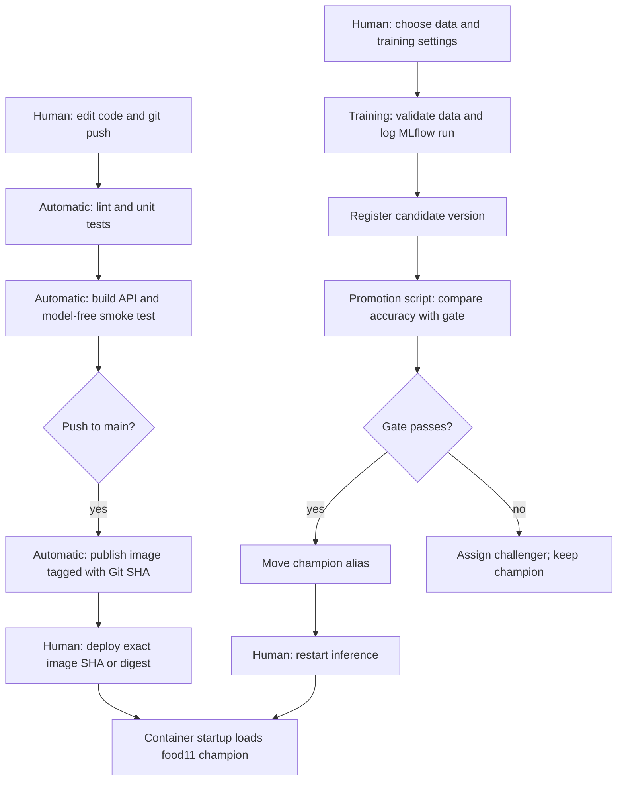

# Lab 5 — CI/CD and Model Promotion

## 1. Isolated unit tests

A real model load can fail because MLflow is down, credentials expire, the alias is absent, artifacts are unreachable, or weights are too large for runner memory. These do not necessarily indicate incorrect API code. `SKIP_MODEL` and an injected fake make unit tests deterministic and independent of those services.

## 2. What the fake proves

The API test exercises multipart upload, image decoding, NCHW preprocessing, canonical class lookup and JSON confidence serialization. It does not measure real classification accuracy, registry access, artifact retrieval or the semantic correctness of trained weights. Invalid-image and malformed-output tests cover error behavior separately.

## 3. Duplicate leakage

The cross-split content-hash check detects the intentionally copied image. A duplicate can inflate evaluation accuracy silently; a corrupt image usually causes a visible failure. The supplied dataset also contained real cross-split duplicates, so generated data was deduplicated before training while preserving the original raw data.

## 4. Where to validate full data

Run the validator before every training execution, after obtaining the DVC snapshot. Also run it on a data-update workstation or a dedicated self-hosted CI runner that can pull the data. Hosted unit tests validate the checker using a small synthetic dataset, including a deliberately introduced duplicate; they do not claim to validate unseen DVC data.

## 5. Job dependencies

With `needs: test`, a failing test job prevents smoke from running. Without it, the jobs can run concurrently and consume build resources despite failing unit tests. Publishing similarly depends on the smoke job.

## 6. Cold and cached run timing

The first main run ([40628472907](https://github.com/Husseinchr/mlops-lab-1/actions/runs/40628472907)) and the required empty-commit repeat, commit `10be507` with message `ci` ([40629150663](https://github.com/Husseinchr/mlops-lab-1/actions/runs/40629150663)), both passed on 28 October 2026.

| Measurement | First run | Repeat |
|---|---:|---:|
| Whole workflow, creation to completion | 369 s | 190 s |
| Test job | 23 s | 25 s |
| `uv sync --frozen` | 5 s | 5 s |
| Pytest | 13 s | 14 s |
| Smoke Docker build | 96 s | 121 s |
| Publishing build/push step | 195 s | 4 s |

The publishing step reused the GitHub Actions Docker cache and existing registry layers, reducing its time substantially. Dependency installation did not show a measurable improvement here; tests still ran, and the smoke build on its separate runner was slower. Cache availability does not guarantee every step becomes faster. setup-uv caches dependency artifacts, while the publishing job separately imports and exports its Docker build cache.

## 7. SHA tags

Suppose laptop A pulls `latest` on Monday and server B pulls it after Tuesday's release. Both commands name `latest`, but cached/running images may contain different code. A commit-SHA tag associates the release with its source revision; a digest pins exact image bytes. The model alias is a separate version decision.

## 8. Token permissions

The test and smoke jobs need only repository read access. Only the publishing job receives `packages: write`. A broadly privileged compromised step could rewrite code or releases, alter repository settings if permitted, or publish malicious packages. Explicit least privilege limits the token's reach.

## 9. Branch protection

A required-check rule blocks merging a pull request until test and smoke pass; requiring a pull request prevents ordinary direct pushes. Enforcement is centralized and repeatable rather than depending on each developer remembering to run local tests. Administrators may bypass rules if the rule permits it. The execution record states whether the rule and deliberately failing PR were actually verified.

In [PR #1](https://github.com/Husseinchr/mlops-lab-1/pull/1), the class-count test was deliberately changed from eleven to twelve. The hosted `test` job failed with `assert 11 == 12`, and `smoke` was skipped ([failed run](https://github.com/Husseinchr/mlops-lab-1/actions/runs/40628663654)). Restoring the assertion produced passing test and smoke jobs ([fixed run](https://github.com/Husseinchr/mlops-lab-1/actions/runs/40628864023)); only then was the PR merged as `4330e06`. The repository reports `main.protected = false`; GitHub reported the failed PR as mergeable with an unstable status. Therefore CI detection worked, but merge blocking is **not enforced** until the owner enables protection. The current account has push permission but no administrator permission.

## 10. Quality gate

The candidate becomes champion only if `candidate >= champion + 2*sqrt(p*(1-p)/n)`. Otherwise it receives `challenger`. Tags record both accuracies, the previous champion version, sample size, margin and decision. The script verifies matching dataset hashes and test sizes before comparing.

The champion's evaluation accuracy was `p = 0.7281021897810219` on `n = 1096` images. Therefore `se = 0.013439829106148112`, and `2*se = 0.026879658212296223`, or **2.688 percentage points**. The replacement threshold was **75.4982%**.

| Candidate version | Learning rate | Evaluation accuracy | Gate decision |
|---|---|---:|---|
| 2 | 0.000001 | 11.5876% | challenger |
| 3 | 0.001 | 72.8102% | challenger |

Both decisions retained champion version 1. The strong candidate reproduced the champion's accuracy exactly, so it did not meet the required improvement. The `challenger` alias ends on version 3, while version 2 retains its recorded decision tags.

This is the prescribed lecture heuristic, not a general significance test for two classifiers evaluated on the same examples; a paired test would use their per-example disagreement.

## 11. Automatic promotion

One option is a post-training step on a self-hosted runner or orchestrated job that can reach the local tracking server. Another is a hosted MLflow server such as DagsHub, with credentials injected into the training/promotion job. Both must preserve the quality gate and log its result.

## 12. Pipeline

The Git commit decides the application code version; the registry version selected by `champion` decides the model weights. Training, candidate registration, promotion invocation and deployment/restart remain explicit local operations in this lab; GitHub automatically tests and publishes the application image.
